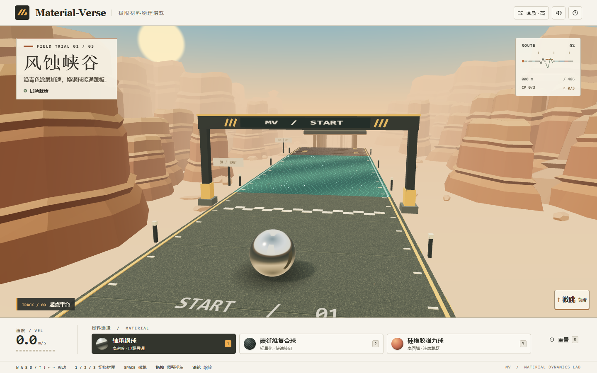

# Material-Verse · 极限材料物理滚珠

一个单文件 3D 滚珠游戏。三关的终点里程依次为 **486 m、516 m、554 m**。每关都包含 S 弯、窄梁、高低分岔和三个科研检查点。

**[打开游戏](https://2770713212.github.io/material-verse/)**



## 玩法

| 材料 | 游戏中的作用 |
| --- | --- |
| 1 · 轴承钢球 | 质量大，同样的侧风力造成的偏移较小。触碰 NiTi 跳板时可以闭合机关电路。 |
| 2 · 碳纤维复合球 | 起步与转向最快。保持向前输入，在青色涂层上提速。 |
| 3 · 硅橡胶弹力球 | 恢复系数为 0.89。第三关从合金跳板起飞后切换，可利用落地反弹连续跨越断层。 |

电脑用 **WASD 或方向键** 移动，**1 / 2 / 3** 换球，**空格** 微跳，**R** 返回最近的检查点。拖动赛道可调整视角，滚轮控制镜头距离。手机用左下摇杆移动，另一根手指可以点右下角的 **微跳**、换球或滑动赛道。微跳冷却 1.2 秒，每次腾空最多使用一次。

青色涂层的接触摩擦系数为 0.001，并沿赛道方向提供推力。NiTi 跳板通电升温后弹起，每 7 秒还有一次热脉冲。第二关流体池的临界水平速度为 **11 m/s**，第三关为 **13 m/s**。速度等于阈值时仍有支撑，减速至阈值以下便会下沉。上述设定用于玩法演示。实际材料响应还受结构、应变率和温度等因素影响。

| 遇到的机关 | 通过方法 |
| --- | --- |
| 微晶玻璃桥 | 提前换碳纤或硅胶。钢球持续承载超过 0.5 秒，玻璃会碎裂并失去支撑。 |
| 75° 强磁侧壁 | 入场前换钢球，保持向前输入。蓝色脉冲标出吸附区。 |
| 红色扫射激光 | 用钢球或碳纤通过。硅胶球接触光束会熔毁。 |

**采样与评级。** 左侧高架捷径有两枚晶体，下层宽道可以绕过高架断缝。第三枚在终段高梁的断缝上方。150、300、450 m 处的发光检查点可保存位置。掉落后约 1.6 秒自动复活，也可立即重置。已采样本和累计用时会保留，进入下一关时重新计算。

计时从首次移动或微跳开始。S 级需要集齐 3 枚样本、零复位，并分别在 62、69、76 秒内完成对应关卡。A 级需要至少 2 枚样本、至多 2 次复位，且用时不超过对应 S 级目标的 1.6 倍。其他完赛成绩记为 B 级。

## 本地运行

游戏逻辑、界面、着色器、程序化纹理和合成音效都在 [index.html](index.html)。浏览器通过 import map 从 jsDelivr 加载固定版本 Three.js 0.160.0 和 cannon-es 0.20.0，首次打开需要联网。桌面默认高画质，触控设备默认流畅画质，可在右上角切换。

如果已安装 Python，在**仓库根目录**运行以下命令，然后打开 [本地游戏](http://127.0.0.1:8000/)。

```sh
python -m http.server 8000 --bind 127.0.0.1
```

## 复现自动试玩

需要 Node.js 和 Chrome。保持上面的 HTTP 服务运行，在**仓库根目录的第二个终端**执行以下命令。Windows 默认使用标准 Chrome 安装路径，其他安装位置可通过环境变量 `CHROME_PATH` 指向浏览器可执行文件。

```sh
npm install --no-save --no-package-lock playwright-core@1.56.1
node qa/playtest.cjs http://127.0.0.1:8000
```

[试玩脚本](qa/playtest.cjs) 通过键盘事件和浏览器原生多点触摸事件驱动滚珠。带 `?verify=1` 的页面允许脚本逐步推进同一套 120 Hz 物理模拟，普通入口使用实时动画循环。脚本从起点跑完三关的高低两线，检查材料克制、微跳冷却、采样、检查点、三档评级和控制台错误，并保存[桌面与手机截图](screenshots)。
